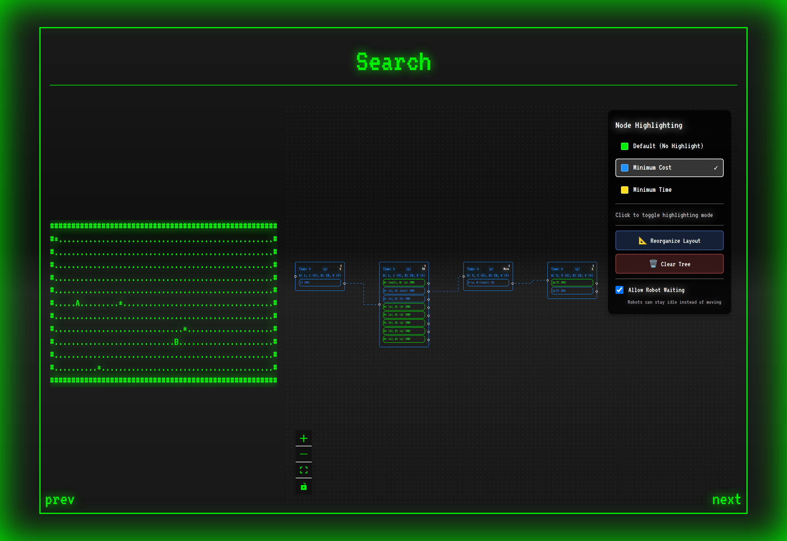
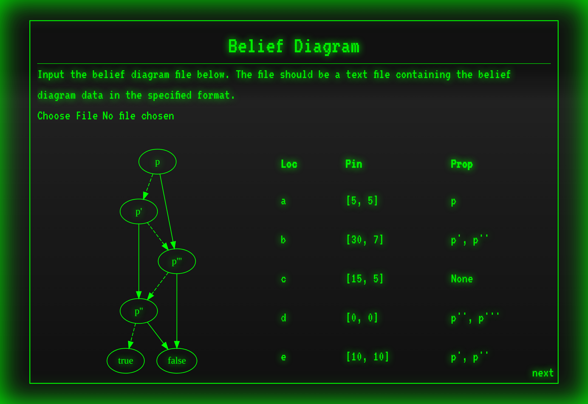
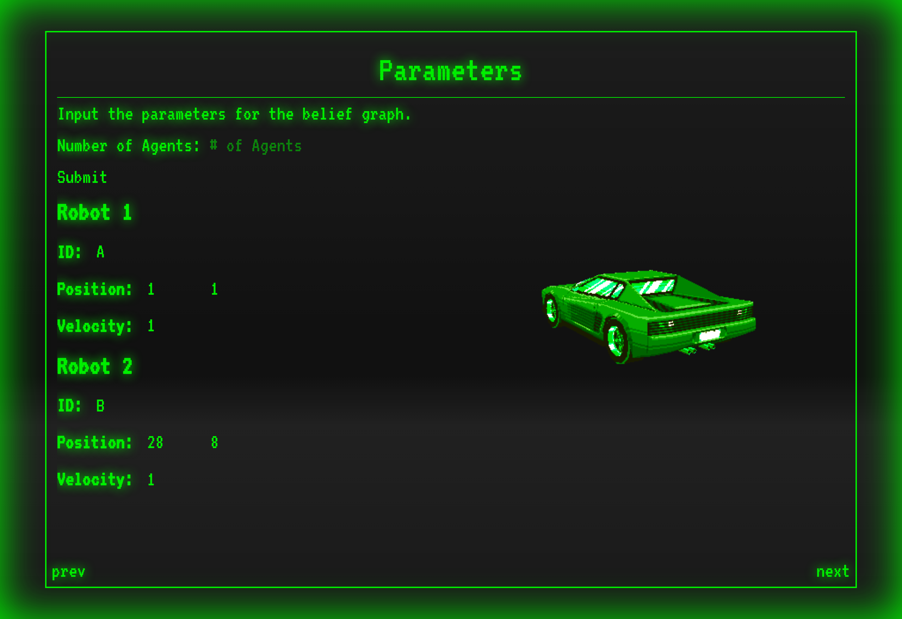
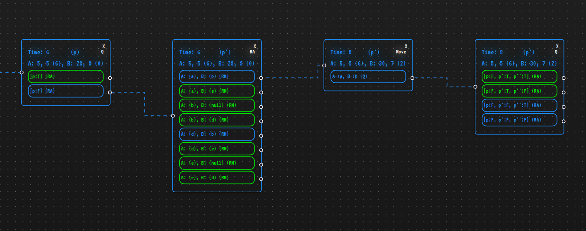

# Project Dinn

Project Dinn is a web app for planning how a team of robots answers a yes/no question by driving to places on a map.

The question comes as a belief diagram: a chart of smaller yes/no questions, called props (propositions), where each answer points to the next prop until the chart ends at true or false. Each prop can be answered at one or more locations, and a robot that reaches a location learns the answers to all props there. Given the diagram, the locations, and each robot's start position and velocity, the app searches over where to send each robot and branches on every answer the robots could find. The result is a tree you open one step at a time. It can highlight the plan with the lowest worst-case total distance driven or the branch that reaches an answer soonest.

Live demo: https://project-dinn.vercel.app



## Walkthrough

The four pages are linked by prev and next buttons and pass data to each other through the browser's localStorage.

### 1. Belief Diagram



Upload a belief diagram as a JSON file ([format below](#input-format)); until you do, the page shows a built-in example. Graphviz draws the diagram: a solid arrow leads to the next prop when the answer is true, a dashed arrow when it is false. The table lists each location (Loc), its x, y position (Pin), and the props a robot learns there (Prop).

### 2. Parameters



Set the number of robots (agents) and each robot's ID, start position, and velocity.

### 3. Search

The screenshot at the top shows this page. The tree starts as a single node, and each button on a node opens the step it names. There are four kinds of steps:

    RA    robot assignment: one button per way to send the robots out
    Move  the robots drive until the next one reaches its location
    Q     a robot arrived: one button per set of answers it could have learned,
          plus a wait button while another robot is still driving
    LEAF  the diagram reached true or false: each robot's final cost and time

Each node shows the time, the prop being asked, and each robot's position with its cost (distance driven so far) in parentheses. Clicking a node puts the robots at those positions on the ASCII map. The map alternates between drawing the locations as `*` and printing their names; robots appear as their IDs.

The legend picks what to highlight:

    Minimum Cost (blue)    the choices with the lowest worst-case total distance driven
    Minimum Time (yellow)  the branch that reaches true or false soonest

Allow Robot Waiting is on by default. It lets a robot stay where it is instead of driving, and it adds the Move steps and wait buttons. Changing it clears the tree and reruns the search. Reorganize Layout lines the nodes up in columns, and Clear Tree starts over.



In the screenshots, robot A starts at (1, 1) and B at (28, 8), both with velocity 1. Only location a answers p, so the minimum-cost plan sends A there first. If p is false, the diagram asks p' next, and B drives to b, which answers p' and p'' at once (the close-up above). If p' is also false, A drives on to d for p'''. That worst case adds up to 5.66 + 2.24 + 7.07 = 14.96, and no plan in the tree has a lower worst case.

### 4. References

Shows the loaded belief diagram as JSON.

## Input format

The application expects a belief diagram in the following JSON format:

```json
{
    "author": "David Zhang",
    "size" : [50, 10],
    "starting_prop": "p",

    "props" : [
        "p",
        "p'",
        "p''",
        "p'''"
    ],
    

    "locations" : {
        "a" : [5, 5],
        "b" : [30, 7],
        "c" : [16, 5],
        "d" : [0, 0],
        "e" : [10, 10]
    },
    "edges" : {
        "p" : ["p'", "p'''"],
        "p'" : ["p'''", "p''"],
        "p''" : ["true", "false"],
        "p'''": ["p''", "false"]
    },

    "prop_to_location" : {
        "p" : ["a"],
        "p'" : ["b", "e"],
        "p''" : ["b", "d", "e"],
        "p'''": ["d"]
    }
}
```

- **author**: String identifying the creator of the belief diagram (optional)
- **size**: Array `[width, height]` defining the canvas dimensions for visualization
- **starting_prop**: String specifying the initial proposition node where traversal begins
- **props**: Array of strings listing all proposition identifiers in the diagram
- **locations**: Object mapping location identifiers to coordinate pairs `[x, y]`
- **edges**: Object mapping each proposition to `[next if false, next if true]`; `"true"` and `"false"` end the diagram
- **prop_to_location**: Object associating each proposition with an array of location identifiers where it can be found

Every field except author is required. `test_files/bd2.json` and `test_files/bd3.json` are sample inputs.

## Run locally

    npm install
    npm run dev                  # http://localhost:3000
    npm test                     # Jest tests in testing/
    npm run build && npm start   # production build

## Built with

Next.js 15 (App Router), React 19 and TypeScript; React Flow (`@xyflow/react`) for the search tree; ts-graphviz and graphviz-react (Graphviz compiled to WebAssembly) for the diagram; Tailwind CSS 4; Jest with ts-jest. The text uses the VT323 font. The live demo runs on Vercel.

## Files

    src/app/page.tsx                    Belief Diagram page
    src/app/belief-graph/page.tsx       Parameters page
    src/app/sim/page.tsx                Search page
    src/app/references/page.tsx         References page
    src/utils/search.ts                 builds the search tree
    src/utils/RobotManager.ts           robot assignments, driving, answer branches
    src/utils/TimeStepNode.ts           one step of the tree: robots, prop asked, answers so far
    src/utils/cost_and_time.ts          minimum cost and minimum time marking
    src/utils/generateFrames.ts         ASCII map frames
    src/components/XYTimeStepNode.tsx   draws one tree node in React Flow
    testing/                            Jest tests
    test_files/                         sample belief diagrams
    docs/screenshots/                   images in this README
